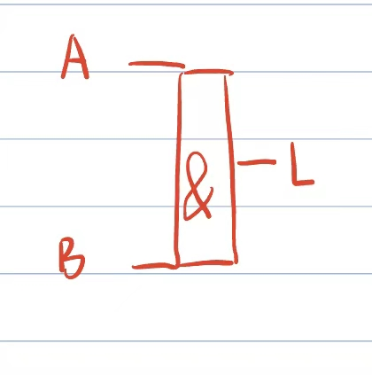
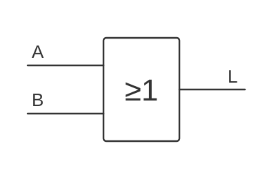
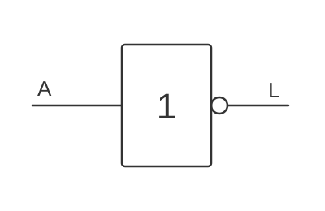
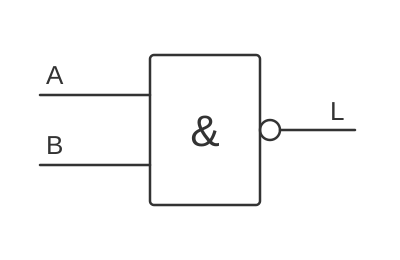
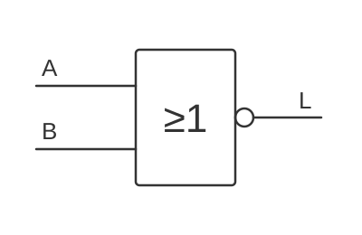
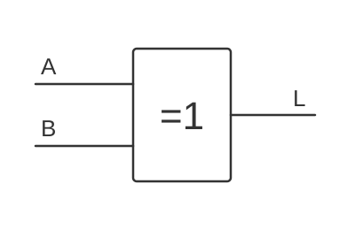
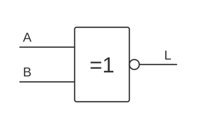

# assign 连续赋值

## 与门 AND Gate

> 一句话：两个输入**同时**为 1，输出才为 1。

### 真值表

| A | B | L |
|:---:|:---:|:---:|
| 0 | 0 | 0 |
| 0 | 1 | 0 |
| 1 | 0 | 0 |
| 1 | 1 | 1 |

### 电路图



### Verilog 代码

```verilog
module and_gate (        // ① 声明一块电路，名字 and_gate，后面括号是引脚表
    input  a,            // ② 输入引脚 a
    input  b,            // ③ 输入引脚 b
    output y             // ④ 输出引脚 y（最后一行不加逗号）
);                       // ⑤ 引脚表结束，分号不能少

    assign y = a & b;    // ⑥ 连续赋值：只要 a 或 b 变，y 立刻跟着变

endmodule                // ⑦ 电路声明结束，必须有
```

## 或门 OR Gate

> 一句话：只要有一个输入为 1，输出就为 1。

### 真值表

| A | B | L |
|:---:|:---:|:---:|
| 0 | 0 | 0 |
| 0 | 1 | 1 |
| 1 | 0 | 1 |
| 1 | 1 | 1 |

### 电路图



图上几个记号：

- **框内的 `≥1`**：IEC 标准里表示"或"，意思是"至少有一个输入为 1"

### Verilog 代码

```verilog
module or_gate (        // 声明一块电路，名字 or_gate
    input  a,           // 输入引脚 a
    input  b,           // 输入引脚 b
    output y            // 输出引脚 y
);

    assign y = a | b;   // 连续赋值：| 表示或运算

endmodule               // 电路声明结束
```

## 非门 NOT Gate

> 一句话：把输入反过来，0 变 1，1 变 0。

### 真值表

| A | L |
|:---:|:---:|
| 0 | 1 |
| 1 | 0 |

### 电路图



图上几个记号：

- **框内的 `1`**：表示"有输入就输出"
- **输出端的小圆**：小圆代表取反

### Verilog 代码

```verilog
module not_gate (
    input  a,
    output y
);

    assign y = ~a;

endmodule
```

## 与非门 NAND Gate

> 一句话：先"与"再取反，只有两个输入都是 1 时输出 0。

### 真值表

| A | B | L |
|:---:|:---:|:---:|
| 0 | 0 | 1 |
| 0 | 1 | 1 |
| 1 | 0 | 1 |
| 1 | 1 | 0 |

### 电路图



图上几个记号：

- **框内的 `&`**：先做与运算
- **输出端的小圆**：再做取反

### Verilog 代码

```verilog
module nand_gate (
    input  a,
    input  b,
    output y
);

    assign y = ~(a & b);

endmodule
```

## 或非门 NOR Gate

> 一句话：先"或"再取反，只有两个输入都是 0 时输出 1。

### 真值表

| A | B | L |
|:---:|:---:|:---:|
| 0 | 0 | 1 |
| 0 | 1 | 0 |
| 1 | 0 | 0 |
| 1 | 1 | 0 |

### 电路图



图上几个记号：

- **框内的 `≥1`**：先做或运算
- **输出端的小圆**：再做取反

### Verilog 代码

```verilog
module nor_gate (
    input  a,
    input  b,
    output y
);

    assign y = ~(a | b);

endmodule
```

## 异或门 XOR Gate

> 一句话：两个输入不同时输出 1，相同时输出 0。

### 真值表

| A | B | L |
|:---:|:---:|:---:|
| 0 | 0 | 0 |
| 0 | 1 | 1 |
| 1 | 0 | 1 |
| 1 | 1 | 0 |

### 电路图



图上几个记号：

- **框内的 `=1`**：IEC 标准里表示"异或"，意思是"输入为 1 的个数正好是 1 个"

### Verilog 代码

```verilog
module xor_gate (
    input  a,
    input  b,
    output y
);

    assign y = a ^ b;

endmodule
```

## 同或门 XNOR Gate

> 一句话：两个输入相同时输出 1，不同时输出 0。

### 真值表

| A | B | L |
|:---:|:---:|:---:|
| 0 | 0 | 1 |
| 0 | 1 | 0 |
| 1 | 0 | 0 |
| 1 | 1 | 1 |

### 电路图



图上几个记号：

- **框内的 `=1`**：先做异或
- **输出端的小圆**：再取反，所以结果变成"相同为 1"

### Verilog 代码

```verilog
module xnor_gate (
    input  a,
    input  b,
    output y
);

    assign y = ~(a ^ b);

endmodule
```
