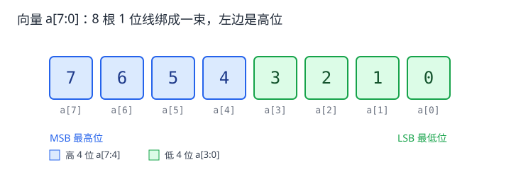
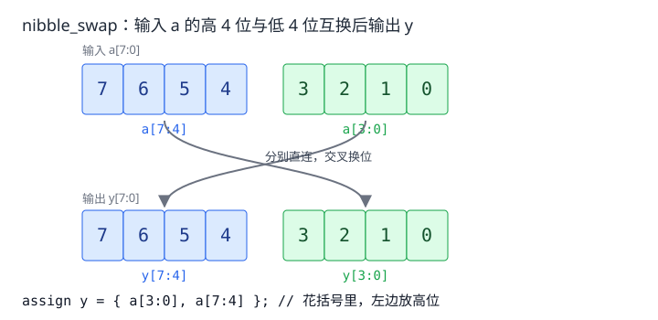

# 向量：多位信号

一根 `wire` 只能传 0 或 1。要传 4 位、8 位数据，就把多根线绑成一束，这叫**向量**。

## 1. 位宽声明

```verilog
input  [7:0] a;    // 8 位输入
output [3:0] y;    // 4 位输出
```



规则：

- `[7:0]` 读作“从第 7 位到第 0 位”，共 8 根线
- **左边是高位（MSB），右边是低位（LSB）**
- 不写方括号 = 1 位

## 2. 常量的写法


```verilog
8'b1010_0011    // 8 位，二进制值 10100011
8'hFF           // 8 位，十六进制 FF
4'd9            // 4 位，十进制 9
```

格式固定为 `位宽 ' 进制 数值`：

| 前缀 | 含义 |
|---|---|
| `b` | 二进制 |
| `h` | 十六进制 |
| `d` | 十进制 |

下划线只是给眼睛分段，编译器会忽略。

## 3. 三种取法

```verilog
assign y = a;        // 整根线，8 位全拿
assign y = a[2];     // 只取第 2 位，结果是 1 位
assign y = a[5:2];   // 取第 5 到第 2 位，结果是 4 位
```

取出来多少位，左边就得接多少位，否则会被补零或截断。

## 4. 拼接：花括号

```verilog
assign y = { a[3:0], a[7:4] };
```



`{}` 把几段线并排拼起来，**左边那段在结果里占高位**。上图这行就是把 8 位数的高低 4 位对调。

复制写法：`{4{a}}` 表示把 `a` 重复 4 遍。

## 5. 多位上的位运算

```verilog
assign y = a & b;    // 每一位各自做与，互不影响
```

`&`、`|`、`^`、`~` 在向量上都是**逐位独立**运算，不会进位。

这也是别用 `&&`、`||` 的原因：它们会把整个向量压成“真/假”一位，多位信息全部丢失。

## 6. 对应源码

`01_basics/vectors/nibble_swap.v`（电路）+ `01_basics/vectors/nibble_swap_tb.v`（测试台），练习任务见 `notes/06-练习.md`。

