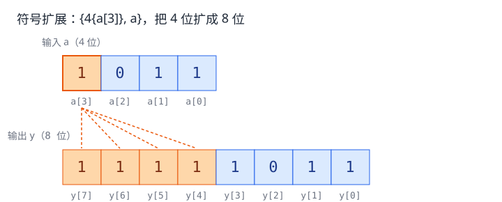

# 练习清单

练习统一放在这里，正文笔记里只讲概念和源码。

## 阶段 2：向量

### 练习 2-1 nibble_swap

- 文件：`01_basics/vectors/nibble_swap.v`、`01_basics/vectors/nibble_swap_tb.v`
- 要求：输入 8 位 `a`，输出 8 位 `y`，把 `a` 的高 4 位与低 4 位互换
- 提示：用拼接 `{}`，正文笔记第 4 节有连线图

运行：

```powershell
cd C:\Users\19918\Documents\verilog-lab\01_basics\vectors
iverilog -o swap.vvp nibble_swap.v nibble_swap_tb.v
vvp swap.vvp
```

验收标准：

```
a=10100011 y=00111010
a=11111111 y=11111111
```

自问：为什么 `1010_0011` 换位后是 `0011_1010`，而不是 `1100_0101`？

### 练习 2-2 sign_extend

- 文件：`01_basics/vectors/sign_extend.v`、`01_basics/vectors/sign_extend_tb.v`
- 要求：把 4 位有符号数 `a` 扩展成 8 位 `y`，新增的高 4 位全部复制符号位 `a[3]`
- 提示：拼接 + 复制，只需一行 `assign`



运行：

```powershell
cd C:\Users\19918\Documents\verilog-lab\01_basics\vectors
iverilog -o ext.vvp sign_extend.v sign_extend_tb.v
vvp ext.vvp
```

验收标准：

```
a=0111 y=00000111
a=1011 y=11111011
```

自问：为什么 `4'b1011` 扩展后是 `1111_1011`，高 4 位不补 0 而是补 1？
