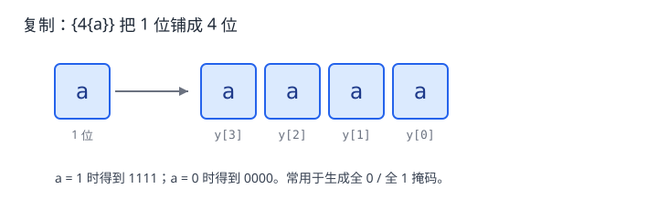
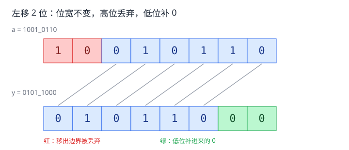
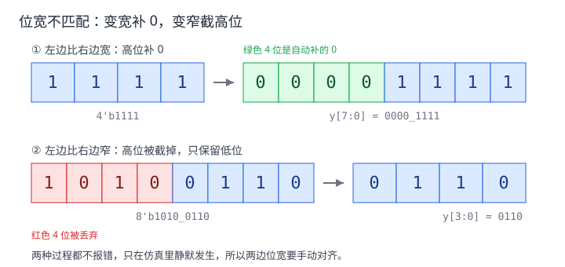

# 复制与移位

阶段 2 的最后两个操作：**复制 `{n{x}}`** 和 **移位 `<<` `>>`**。两者都不改变数据本身的位宽。

## 1. 复制运算符



```verilog
assign y = {4{a}};          // a 重复 4 次，结果 4 位
assign y = {2{4'hF}};       // 4'hF 重复 2 次，结果 8'hFF
```

格式是 `{次数{内容}}`，次数必须是常数。

## 2. 移位



```verilog
assign y = a << 2;   // 左移：低位补 0，高位被挤掉
assign y = a >> 3;   // 右移：高位补 0，低位被挤掉
```

必须记住：

- **移位不改变位宽**，超出边界的位直接消失
- 无符号数里，左移 1 位 = 乘 2，右移 1 位 = 除 2 取整
- `>>` 是逻辑右移，高位补 0；补符号位的是 `>>>`，到有符号数再说

## 3. 位宽不匹配

```verilog
wire [7:0] y;
assign y = 4'b1111;     // 结果 0000_1111，高位自动补 0
```



规则：**左边宽 → 补 0；左边窄 → 截掉高位，保留低位**。这个过程不报错，只会静默出错，所以两边位宽要手动对齐。

## 4. 对应源码与练习

- 源码：`01_basics/vectors/replicate_shift.v`（复制、左移、右移、补零四个模块）+ `01_basics/vectors/replicate_shift_tb.v`
- 练习 2-2 `sign_extend`（符号扩展）见 `notes/06-练习.md`

运行：

```powershell
cd C:\Users\19918\Documents\verilog-lab\01_basics\vectors
iverilog -o demo.vvp replicate_shift.v replicate_shift_tb.v
vvp demo.vvp
```

预期输出：

```
复制  a=1 y=1111
复制  a=0 y=0000
左移2 a=10010110 y=01011000
右移3 a=10010110 y=00010010
补零  a=1111 y=00001111
```
