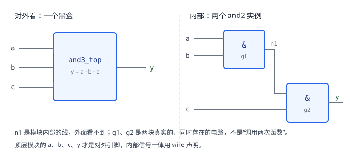
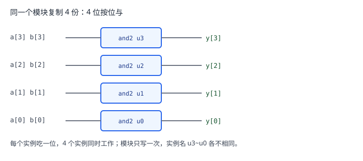

# 08 模块层次：把电路当积木拼

> 阶段 3 的第一篇。这篇只讲一件事：**怎么在一个模块内部使用另一个模块**。理解了这一篇，后面的半加器、全加器、n 位加法器都是同一个套路。

## 1. 什么是“层次”

写 C 语言时你不会每次排序都重写一遍快排，而是调用写好的函数。硬件里也一样：

- 小模块：与门、半加器、计数器
- 大模块：加法器、CPU 算术单元

大模块不需要知道小模块内部怎么实现，只需要知道它的**引脚**。这就是层次化设计。

两种画法的对比：

**平铺**：想要一个三输入与门，就画一个三输入的与门。

**层次**：用两个二输入与门串起来，第二个门的输入接第一个门的输出。

两种都能实现 `y = a·b·c`，但层次写法里“二输入与门”这个零件可以反复用，换成 8 输入也不用重新设计。

## 2. 第一个例子：用两个二输入与门拼三输入与门

先写零件：

```verilog
module and2 (          // 二输入与门，这就是“积木”
    input  a,
    input  b,
    output y
);
    assign y = a & b;
endmodule
```

再写上层，在内部“放两块”：

```verilog
module and3_top (
    input  a,
    input  b,
    input  c,
    output y
);

    wire n1;                        // 两块积木之间的连线

    and2 g1 ( .a(a),  .b(b),  .y(n1) );   // 第一块：n1 = a & b
    and2 g2 ( .a(n1), .b(c),  .y(y)  );   // 第二块：y  = n1 & c

endmodule
```



三处关键：

1. **`and2` 是模块名，`g1`、`g2` 是实例名**。模块名决定“用哪种积木”，实例名决定“这块积木叫什么”，同一个模块可以放很多块，但实例名不能重复。
2. **`n1` 是模块内部自己拉的线**，外面看不到。它必须用 `wire` 声明，因为它是被两个实例驱动的导线。
3. **实例化的本质是复制电路，不是调用函数**。两块 `and2` 是同时存在的两份硬件，一直在工作，没有“先执行 g1 再执行 g2”这种顺序。

## 3. 第二个例子：同一个模块复制多份

需求：写一个 4 位按位与，`y[i] = a[i] & b[i]`。

零件还是 `and2`，只是要放四块：

```verilog
module and4_vec (
    input  [3:0] a,
    input  [3:0] b,
    output [3:0] y
);

    and2 u0 ( .a(a[0]), .b(b[0]), .y(y[0]) );
    and2 u1 ( .a(a[1]), .b(b[1]), .y(y[1]) );
    and2 u2 ( .a(a[2]), .b(b[2]), .y(y[2]) );
    and2 u3 ( .a(a[3]), .b(b[3]), .y(y[3]) );

endmodule
```



这个例子说明：

- 端口可以接向量的**某一位**，`a[0]` 就是一根线
- 四块积木各管一位，互不影响，天然并行
- 写四遍很啰嗦，阶段 5 会用 `generate for` 自动生成这种重复结构

## 4. 两种端口连接方式

| 写法 | 例子 | 特点 |
|---|---|---|
| 命名连接 | `and2 g1 ( .a(a), .b(b), .y(n1) );` | 顺序无关，推荐；`.a` 是模块的端口名 |
| 位置连接 | `and2 g1 ( a, b, n1 );` | 必须和模块定义时的端口顺序完全一致 |

位置连接少打字，但一旦模块改了端口顺序，上层全部静默出错——**不报错，结果错**。所以实际项目一律用命名连接。

命名连接还有一种偷懒写法：同名时可以只写 `.a`，工具自动接同名的 `a`：

```verilog
and2 g1 ( .a, .b, .y );    // 要求外面恰好有同名的 a、b、y
```

能读懂就行，工程上少用，因为看不出到底接了什么。

## 5. 模块内部的线从哪来

三种来源，都是 `wire`：

| 来源 | 例子 | 说明 |
|---|---|---|
| 实例的输出 | `and2 g1 (..., .y(n1));` | n1 由这块积木驱动 |
| `assign` 连续赋值 | `assign n2 = n1 & c;` | 被表达式驱动 |
| 门级原语 | `and (n3, n1, n2);` | 被门驱动 |

不能做的事：**在 `always` / `initial` 里给 wire 赋值**，那需要 `reg`（阶段 4 讲）。

一句话：**wire 是由别人驱动的线，reg 是自己被赋值的变量**。

## 6. 文件怎么放、怎么编译

一个模块一个文件，文件名和模块名一致，都放在同一目录：

```
01_basics/modules/
├── and2.v          ← module and2
├── and3_top.v      ← module and3_top（用了 and2）
└── and3_tb.v       ← module and3_tb（测试台）
```

编译时**把所有相关文件都列出来**，iverilog 会自动找依赖：

```powershell
iverilog -o and3.vvp and2.v and3_top.v and3_tb.v
vvp and3.vvp
```

只写 `and3_tb.v` 会报：

```
error: Unknown module type: and2
```

因为它只看到了测试台，没看到零件的定义。

## 7. 层次里的“顶层”

一个设计是一棵树：

```
and3_tb        ← 测试台（最外层，不被综合）
└── and3_top   ← 设计顶层
    ├── and2 g1
    └── and2 g2
```

- **测试台永远在最外面**，它不被综合成硬件
- 设计顶层是“整个芯片对外露出的那层”
- 越往下越基础，最底层是门甚至晶体管

以后写大项目，先画这棵树，再按树写文件，基本不会乱。

## 8. 常见错误

| 现象 | 原因 | 修法 |
|---|---|---|
| `Unknown module type: and2` | 编译时漏了 `and2.v` | 把所有 `.v` 都列上 |
| 结果全是 `x` | 内部连线没声明，或实例名重复 | 显式 `wire n1;`，实例名唯一 |
| 结果错但能编译 | 用了位置连接，端口顺序错 | 改命名连接 |
| `Port not found` | `.aa(a)` 端口名拼错 | 对照模块定义的端口名 |

## 9. 对应源码

| 文件 | 内容 |
|---|---|
| `01_basics/modules/half_adder.v` | 半加器（下一篇的主角） |
| `01_basics/modules/full_adder.v` | 全加器，内部放了两块半加器 |

下一篇先单独讲半加器，再讲全加器怎么用两块半加器拼出来——那时你会看到同一套实例化语法。
