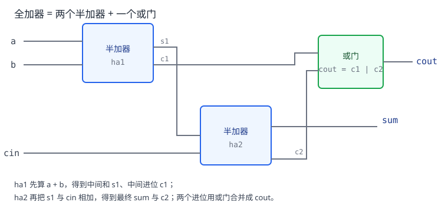

# 08 模块层次与加法器

> 阶段 3 的目标：学会把已有的小模块当积木，拼成更大的电路。加法器是最好的例子——从半加器到全加器，再到多位加法器，一层套一层。

## 1. 为什么要有层次

到现在为止，每个 `.v` 文件都是孤立的一个模块。真实设计不是这样：

- CPU 的算术单元由加法器组成
- 加法器由全加器组成
- 全加器由半加器和或门组成

每层只关心下一层的接口，不关心它内部怎么实现。这样几十万门的设计才管得过来。

## 2. 实例化语法

在模块内部“放一颗芯片”，和测试台里的写法完全一样：

```verilog
half_adder ha1 (        // 模块名  实例名
    .a(a),              // .端口名(接进来的信号)
    .b(b),
    .sum(s1),
    .cout(c1)
);
```

两种连接方式：

| 写法 | 例子 | 特点 |
|---|---|---|
| 命名连接 | `.a(a), .b(b)` | 顺序无关，推荐 |
| 位置连接 | `(a, b, s1, c1)` | 必须和端口定义顺序一致，改端口就出错 |

模块内部用来连接的线，要自己声明成 `wire`，比如上面的 `s1`、`c1`。它们不是端口，对外不可见。

## 3. 半加器：最小的加法单元

半加器把两个 1 位数相加，输出本位和与进位：

| a | b | sum | cout | 说明 |
|---|---|---|---|---|
| 0 | 0 | 0 | 0 | 0+0 = 0 |
| 0 | 1 | 1 | 0 | 0+1 = 1 |
| 1 | 0 | 1 | 0 | 1+0 = 1 |
| 1 | 1 | 0 | 1 | 1+1 = 10 |

- `sum = a ^ b`：两个数不同才写 1
- `cout = a & b`：两个数都是 1 才会“满 2 进 1”

**为什么叫“半”**：它没有接收低位进位的输入，所以没法串联——第一位算完的进位，第二位接不住。

## 4. 全加器：补上 cin

全加器多一个输入 `cin`（carry in），来自低一位的进位：

| a | b | cin | sum | cout | 说明 |
|---|---|---|---|---|---|
| 0 | 0 | 0 | 0 | 0 | 0+0+0 = 0 |
| 0 | 0 | 1 | 1 | 0 | 0+0+1 = 1 |
| 0 | 1 | 0 | 1 | 0 | 0+1+0 = 1 |
| 0 | 1 | 1 | 0 | 1 | 0+1+1 = 10 |
| 1 | 0 | 0 | 1 | 0 | 1+0+0 = 1 |
| 1 | 0 | 1 | 0 | 1 | 1+0+1 = 10 |
| 1 | 1 | 0 | 0 | 1 | 1+1+0 = 10 |
| 1 | 1 | 1 | 1 | 1 | 1+1+1 = 11 |

逻辑式：

```
sum  = a ^ b ^ cin
cout = (a & b) | (cin & (a ^ b))
```

## 5. 用两个半加器拼出来

全加器可以拆成 `(a + b) + cin` 两步：



- **ha1** 先算 `a + b`，得到 `s1`、`c1`
- **ha2** 再算 `s1 + cin`，得到最终 `sum` 和 `c2`
- 两个进位用或门合并：`cout = c1 | c2`

代码结构（完整版见源码）：

```verilog
wire s1, c1, c2;         // 模块内部的连线

half_adder ha1 ( .a(a),  .b(b),   .sum(s1),  .cout(c1) );
half_adder ha2 ( .a(s1), .b(cin), .sum(sum), .cout(c2) );

assign cout = c1 | c2;
```

注意 `ha2` 的 `.sum(sum)`：内部信号可以直接接到模块的输出端口，不需要中转。

## 6. 为什么两个进位能用或门合并

因为 `c1` 和 `c2` 不可能同时为 1：

- `c1 = 1` 要求 `a = b = 1`，此时 `s1 = a ^ b = 0`
- `s1 = 0`，则 `c2 = s1 & cin = 0`

所以两者最多一个为 1，或门不会产生冲突。

## 7. 延伸：n 位加法器

把 n 个全加器串起来，前一级的 `cout` 接后一级的 `cin`，就得到 **n 位行波进位加法器**：

```
a3 b3      a2 b2      a1 b1      a0 b0
  │  │       │  │       │  │       │  │
┌─▼──▼─┐   ┌─▼──▼─┐   ┌─▼──▼─┐   ┌─▼──▼─┐
│ 全加器│◄──│ 全加器│◄──│ 全加器│◄──│ 全加器│◄── cin = 0
└──┬───┘   └──┬───┘   └──┬───┘   └──┬───┘
  s3         s2         s1         s0
```

它的缺点是进位要一位一位往上传，位数越多越慢。所以真实 CPU 里用的是超前进位加法器（CLA），那是后面的事。

## 8. 常见错误

**错误 1：内部连线没声明**

```verilog
half_adder ha1 ( .a(a), .b(b), .sum(s1), .cout(c1) );   // s1 未声明
```

`iverilog` 会报 `implicit wire` 相关警告或错误，行为不可靠。模块内部连线一律显式写 `wire`。

**错误 2：两个实例重名**

```verilog
half_adder ha ( ... );
half_adder ha ( ... );    // 同一模块内实例名不能重复
```

**错误 3：位置连接把端口顺序搞错**

```verilog
half_adder ha1 ( a, b, cout, sum );   // cout 和 sum 接反，编译不报错，结果全错
```

这就是推荐命名连接的原因。

**错误 4：漏掉被依赖的源文件**

```powershell
iverilog -o fa.vvp full_adder.v full_adder_tb.v    # 少了 half_adder.v
```

会报 `Unknown module type: half_adder`。

## 9. 对应源码与运行

| 文件 | 内容 |
|---|---|
| `01_basics/modules/half_adder.v` | 半加器 |
| `01_basics/modules/full_adder.v` | 全加器（用两个半加器 + 或门） |
| `01_basics/modules/full_adder_tb.v` | 穷举 8 种输入组合 |

```powershell
cd C:\Users\19918\Documents\verilog-lab\01_basics\modules
iverilog -o fa.vvp half_adder.v full_adder.v full_adder_tb.v
vvp fa.vvp
```

预期输出：

```
a=0 b=0 cin=0 | sum=0 cout=0
a=0 b=0 cin=1 | sum=1 cout=0
a=0 b=1 cin=0 | sum=1 cout=0
a=0 b=1 cin=1 | sum=0 cout=1
a=1 b=0 cin=0 | sum=1 cout=0
a=1 b=0 cin=1 | sum=0 cout=1
a=1 b=1 cin=0 | sum=0 cout=1
a=1 b=1 cin=1 | sum=1 cout=1
```

自己先算一遍 `a=1 b=1 cin=1` 那行：`1+1+1 = 3 = 11`，所以 `sum=1`、`cout=1`。输出对上了，说明两层实例化都接对了。
