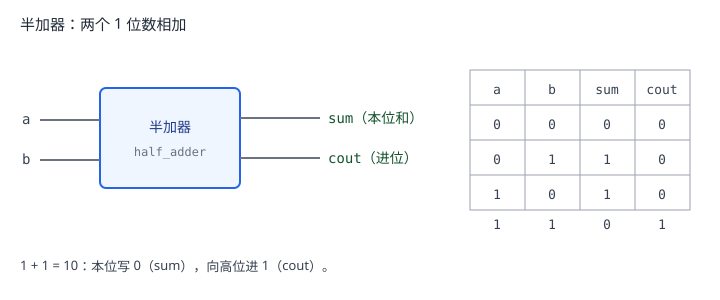

# 09 半加器

> 阶段 3 的第二篇。半加器是最小的加法单元，也是全加器的零件。

## 1. 它要解决什么

两个 1 位二进制数相加。结果可能是 `0`、`1`、`10`——最后一种需要两根线才能表示：

- `sum`：本位和，也就是结果的个位
- `cout`：进位，也就是结果的十位



十进制类比：`5 + 7 = 12`，个位写 `2`，向十位进 `1`。二进制一样：`1 + 1 = 10`，本位写 `0`，向高位进 `1`。

## 2. 从真值表推逻辑式

| a | b | sum | cout |
|---|---|---|---|
| 0 | 0 | 0 | 0 |
| 0 | 1 | 1 | 0 |
| 1 | 0 | 1 | 0 |
| 1 | 1 | 0 | 1 |

**推 sum**：输出为 1 的行是 m1（`a=0,b=1`）和 m2（`a=1,b=0`）：

```
sum = ~a·b + a·~b = a ^ b
```

这正是异或的定义：两个输入不同才为 1。

**推 cout**：输出为 1 的行只有 m3（`a=1,b=1`）：

```
cout = a · b
```

只有一个乘积项，无需化简，就是与门。

> 完整的三步推导法（找 1 行 → 写乘积项 → 相加化简）见 `05-向量` 之后的加法器笔记，这里只给结论。

## 3. 代码

```verilog
module half_adder (
    input  a,
    input  b,
    output sum,
    output cout
);

    assign sum  = a ^ b;    // 不同则 1：1+0、0+1 本位为 1
    assign cout = a & b;    // 同时为 1 才满 2，产生进位

endmodule
```

两行 `assign` 同时存在，电路一直并行工作——不存在“先算 sum 再算 cout”。

## 4. 为什么叫“半”

因为它只有两个输入，**没有接收低位进位的引脚**。

多位加法时，第 0 位算完要把进位送到第 1 位，第 1 位必须能“接着”这个进位继续加。半加器接不住，所以它只能当零件用，不能直接串联。

补上 `cin` 输入的版本就是**全加器**，下一篇讲——它的做法正是“用两个半加器 + 一个或门”。

## 5. 对应源码

`01_basics/modules/half_adder.v`，注释里有真值表和逐行解释。
