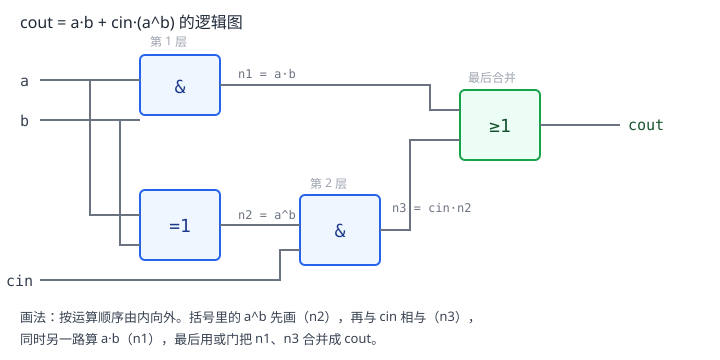
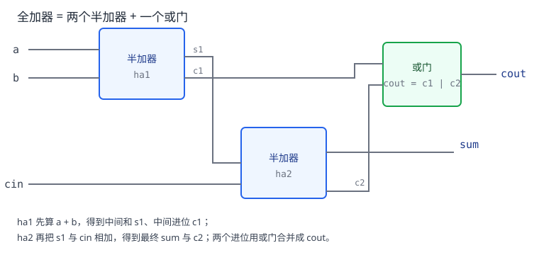

# 10 全加器

> 阶段 3 的第三篇。全加器 = 半加器 + 一个“接收低位进位”的能力。这篇把两条设计路线都走一遍：从真值表推逻辑式，以及用两个半加器拼。

## 1. 需求

输入三个 1 位数 `a`、`b`、`cin`（`cin` 来自低一位的进位），输出本位和 `sum` 和向高位的进位 `cout`。

| a | b | cin | sum | cout | 说明 |
|---|---|---|---|---|---|
| 0 | 0 | 0 | 0 | 0 | 0+0+0 = 0 |
| 0 | 0 | 1 | 1 | 0 | 0+0+1 = 1 |
| 0 | 1 | 0 | 1 | 0 | 0+1+0 = 1 |
| 0 | 1 | 1 | 0 | 1 | 0+1+1 = 10 |
| 1 | 0 | 0 | 1 | 0 | 1+0+0 = 1 |
| 1 | 0 | 1 | 0 | 1 | 1+0+1 = 10 |
| 1 | 1 | 0 | 0 | 1 | 1+1+0 = 10 |
| 1 | 1 | 1 | 1 | 1 | 1+1+1 = 11 |

## 2. 路线一：从真值表推逻辑式

三步：**找 1 行 → 写乘积项 → 或起来化简**。

| 行号 | a b cin | sum | cout |
|---|---|---|---|
| m0 | 0 0 0 | 0 | 0 |
| m1 | 0 0 1 | 1 | 0 |
| m2 | 0 1 0 | 1 | 0 |
| m3 | 0 1 1 | 0 | 1 |
| m4 | 1 0 0 | 1 | 0 |
| m5 | 1 0 1 | 0 | 1 |
| m6 | 1 1 0 | 0 | 1 |
| m7 | 1 1 1 | 1 | 1 |

### 2.1 推 sum

`sum = 1` 的行：m1、m2、m4、m7。

```
sum = ~a·~b·cin + ~a·b·~cin + a·~b·~cin + a·b·cin
```

按 cin 分组：

```
sum = cin·(~a·~b + a·b) + ~cin·(~a·b + a·~b)
```

两个括号分别是“同或”和“异或”：

```
sum = cin·~(a^b) + ~cin·(a^b) = a ^ b ^ cin
```

### 2.2 推 cout

`cout = 1` 的行：m3、m5、m6、m7。

```
cout = ~a·b·cin + a·~b·cin + a·b·~cin + a·b·cin
```

前两项提取 `cin`，后两项提取 `a·b`：

```
cout = cin·(a^b) + a·b·(~cin + cin)
     = a·b + cin·(a^b)
```

用到的两条规则：`X·Y + X·~Y = X`（合并相邻项）、`~X + X = 1`（互补）。

## 3. 把逻辑式画成逻辑图

`cout = a·b + cin·(a^b)`，由内向外画：先算 `a^b`，再与 `cin` 相与，同时另一路算 `a·b`，最后或起来。



对应的门级写法（和上图一一对应）：

```verilog
wire n1, n2, n3;

and g1 (n1, a, b);        // n1 = a·b
xor g2 (n2, a, b);        // n2 = a^b
and g3 (n3, cin, n2);     // n3 = cin·n2
or  g4 (cout, n1, n3);    // cout = n1 + n3
```

日常写代码用一行 `assign` 代替这四行，功能完全相同。

## 4. 路线二：用两个半加器拼

算术分解：`a + b + cin = (a + b) + cin`。

第一次相加交给半加器，第二次相加再交给一个半加器，两个进位用或门合并。



- **ha1**：算 `a + b`，得到 `s1`、`c1`
- **ha2**：算 `s1 + cin`，得到最终 `sum` 和 `c2`
- `cout = c1 | c2`

```verilog
wire s1, c1, c2;

half_adder ha1 ( .a(a),  .b(b),   .sum(s1),  .cout(c1) );
half_adder ha2 ( .a(s1), .b(cin), .sum(sum), .cout(c2) );

assign cout = c1 | c2;
```

### 4.1 两条路线的关系

| | 逻辑推导（第 2~3 节） | 结构分解（本节） |
|---|---|---|
| 起点 | 真值表 / 功能描述 | 已有可复用的半加器 |
| 做法 | 最小项、布尔化简 | 把 `a+b+cin` 拆成 `(a+b)+cin` |
| 擅长 | 陌生功能、小规模电路 | 大电路、多位扩展、层次化 |
| 产出 | 最简逻辑式 → 门图 | 模块连接图 |
| 风险 | 化简后不好复用 | 拆错功能就错，要靠逻辑式兜底 |

两条路线最后会汇合。把逻辑式因式分解，注意 `a^b` 出现两次：

```
sum  = (a ^ b) ^ cin
cout = a·b + cin·(a ^ b)
```

令 `s1 = a^b`、`c1 = a·b`，立刻变成半加器的形状：

```
sum  = s1 ^ cin
cout = c1 + cin·s1
```

反过来代入半加器定义，也能还原出 `sum = a^b^cin`、`cout = ab + cin(a^b)`，与第 2 节一致。

**结论**：逻辑推导负责确认“算得对”，结构分解负责让它“能复用、能扩展”。真实设计两者交替用。

### 4.2 为什么两个进位能直接或起来

因为 `c1` 和 `c2` 不可能同时为 1：

- `c1 = 1` 要求 `a = b = 1`，此时 `s1 = a^b = 0`
- `s1 = 0` 导致 `c2 = s1·cin = 0`

所以最多一个为 1，或门不会产生冲突。

## 5. 验证

```powershell
cd C:\Users\19918\Documents\verilog-lab\01_basics\modules
iverilog -o fa.vvp half_adder.v full_adder.v full_adder_tb.v
vvp fa.vvp
```

预期输出 8 行，最后一行是 `a=1 b=1 cin=1 | sum=1 cout=1`——`1+1+1 = 3 = 11`，正好验证“满 2 进 1”。

## 6. 延伸：n 位加法器

把 n 个全加器串起来，前一级 `cout` 接后一级 `cin`：

```
a3 b3      a2 b2      a1 b1      a0 b0
  │  │       │  │       │  │       │  │
┌─▼──▼─┐   ┌─▼──▼─┐   ┌─▼──▼─┐   ┌─▼──▼─┐
│ 全加器│◄──│ 全加器│◄──│ 全加器│◄──│ 全加器│◄── cin = 0
└──┬───┘   └──┬───┘   └──┬───┘   └──┬───┘
  s3         s2         s1         s0
```

叫**行波进位加法器**。缺点是进位要一位一位往上传，位数越多越慢；真实 CPU 用超前进位加法器（CLA），那是后面的事。

## 7. 常见错误

| 现象 | 原因 |
|---|---|
| `Unknown module type: half_adder` | 编译时漏了 `half_adder.v` |
| 结果全 `x` | `s1`、`c1`、`c2` 没声明成 `wire` |
| 编译不报错但结果错 | 位置连接端口顺序写反 |
| 同一模块内实例重名 | 两个 `half_adder ha1 (...)` |

## 8. 对应源码

| 文件 | 内容 |
|---|---|
| `01_basics/modules/half_adder.v` | 半加器 |
| `01_basics/modules/full_adder.v` | 全加器（两个半加器 + 或门） |
| `01_basics/modules/full_adder_tb.v` | 穷举 8 种组合的测试台 |
