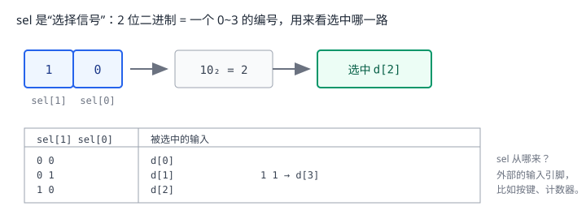
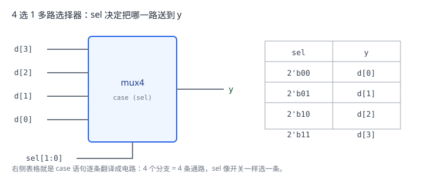
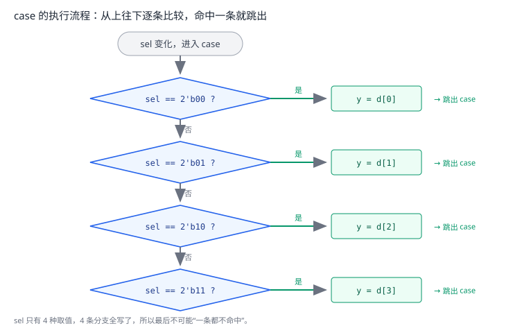
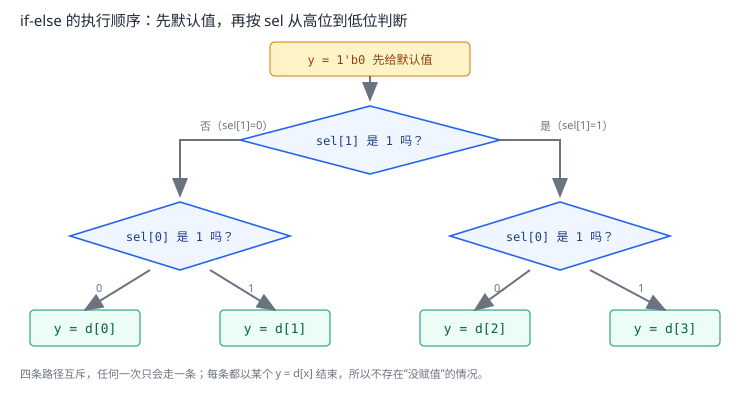

# 11 always 与组合逻辑

> 阶段 4 的第一篇。从这一篇开始，代码里出现 `always`、`if`、`case`——写法像软件，但描述的仍然是硬件。这一步最容易用 C 语言的思维理解错，需要慢一点。

## 1. 阶段 4 要讲什么

前三阶段都在“连线”：`assign` 一行描述一根线，`wire` 就是导线。真实芯片还有两个东西：

| 阶段 4 的三篇 | 内容 | 典型电路 |
|---|---|---|
| 11（本篇） | `always @(*)` 组合逻辑 | 多路选择器、译码器、算术运算 |
| 12 | `always @(posedge clk)` 时序逻辑 | 触发器、寄存器、计数器 |
| 13 | 有限状态机（FSM） | 控制单元、协议收发状态机 |

区别一句话：

- **组合逻辑**：输出只看当前输入，不看历史。给同样的输入，永远同样的输出。
- **时序逻辑**：输出还取决于“上一个时钟沿发生了什么”，电路有记忆。

本篇只做组合逻辑，但用的是 `always` 这个“像软件”的语法。

## 2. 为什么还需要 always

### 2.1 先搞清楚 `sel` 是什么

`sel` 是 **select（选择）** 的缩写，一个“选择信号”。它是一根或几根输入线，告诉电路“这次用哪一路数据”。



- `sel` 只有 1 位时：`0` 选 a，`1` 选 b，只能二选一
- `sel` 有 2 位时：能表示 `00 / 01 / 10 / 11` 四种取值，正好选四路

`sel` 本身不是数据，它不参与运算，只是一个“编号”。就像遥控器上的频道号，频道号不是节目内容，但决定了你看哪个台。

它从哪来？外部的输入引脚（按键、拨码开关），或者电路内部的数据（比如计数器输出、CPU 的指令字段）。

### 2.2 第一行：二选一

```verilog
assign y = sel ? b : a;
```

逐段读：

| 片段 | 含义 |
|---|---|
| `assign` | 连续赋值，y 永远等于右边 |
| `y` | 输出 |
| `=` | 等于 |
| `sel` | 条件，1 位信号 |
| `?` | “如果为真，取……”（三目的开始） |
| `b` | `sel` 为 1 时取 b |
| `:` | “否则取……” |
| `a` | `sel` 为 0 时取 a |

整句读作：**sel 为 1 就输出 b，否则输出 a。** 等价于一个小开关。

### 2.3 第二行：四选一（嵌套三目）

```verilog
assign y = sel[1] ? (sel[0] ? d : c) : (sel[0] ? b : a);
```

先看外层，再看两个括号：

| 片段 | 含义 |
|---|---|
| `sel[1] ?` | 先判断高位：sel 的 bit1 是 1 吗 |
| `(sel[0] ? d : c)` | 是 1 时走这里：再看 bit0，为 1 取 d，否则取 c |
| `:` | 否则 |
| `(sel[0] ? b : a)` | 是 0 时走这里：再看 bit0，为 1 取 b，否则取 a |

四种组合一一对应：

| sel[1] | sel[0] | 取值 | 即 sel |
|---|---|---|---|
| 0 | 0 | a | `2'b00` |
| 0 | 1 | b | `2'b01` |
| 1 | 0 | c | `2'b10` |
| 1 | 1 | d | `2'b11` |

到四路还能硬看，八路就要套四层括号，几乎没法维护，这就是需要 `always` + `case` 的原因。

## 3. 语法

```verilog
always @(*) begin
    // if / case / 多条赋值
end
```

| 部分 | 含义 |
|---|---|
| `always` | 一个“一直重复执行”的过程块 |
| `@(*)` | 敏感列表，`*` 表示“块里读到的任何信号一变，就重算” |
| `begin ... end` | 相当于 C 的 `{}` |
| 块内的 `=` | 阻塞赋值，按书写顺序执行 |

`@(*)` 的效果和 `assign` 一样：输入变，输出立刻跟着重算。综合出来还是纯门电路，**没有时钟、没有存储**。

## 4. 例子：4 选 1 多路选择器



**case 写法**：

```verilog
module mux4_case (
    input  [3:0] d,        // 4 路数据输入，d[0]~d[3] 各是一根线
    input  [1:0] sel,      // 2 位选择信号，取值 00~11
    output reg   y         // 被 always 赋值，必须声明为 reg
);

    always @(*) begin       // 输入一变就重算（组合逻辑）
        case (sel)          // 拿 sel 的值去和下面每条比较
            2'b00: y = d[0];   // sel 等于 00 → 选中第 0 路
            2'b01: y = d[1];   // sel 等于 01 → 选中第 1 路
            2'b10: y = d[2];   // sel 等于 10 → 选中第 2 路
            2'b11: y = d[3];   // sel 等于 11 → 选中第 3 路
        endcase             // 命中一条就跳出，不再看后面的
    end

endmodule
```

**这 5 行 case 的书写逻辑**（照着这三步写，不会漏）：

1. **先列映射表**：`sel` 有哪几种取值，每种取值对应哪一路数据。就是 `mux4.svg` 右边那张表，四条。
2. **一行一条翻译**：左边写取值 `2'b00`，冒号 `:` 后面写“这个取值下 y 等于谁”。
3. **检查覆盖**：`sel` 是 2 位，一共 `2² = 4` 种取值，表里有 4 行，没有遗漏 → 不会生成锁存器。

其中冒号 `:` 读作“当取值是……时”，不是范围，也不是赋值号。

`case` 逐条比较的执行流程：



**if-else 写法**（功能完全一样）：

```verilog
always @(*) begin
    y = 1'b0;                  // 第 1 步：先给默认值，保证任何路径都有值

    if (sel[1]) begin          // 第 2 步：先看高位
        if (sel[0]) y = d[3];  // 高位 1、低位 1 → sel=11 → d[3]
        else        y = d[2];  // 高位 1、低位 0 → sel=10 → d[2]
    end
    else begin                 // 第 3 步：高位为 0 的情况
        if (sel[0]) y = d[1];  // 高位 0、低位 1 → sel=01 → d[1]
        else        y = d[0];  // 高位 0、低位 0 → sel=00 → d[0]
    end
end
```

**执行顺序**（不是从上到下全跑一遍，而是只走一条路）：

1. 先把 `y` 置 0
2. 判断 `sel[1]`
3. 按判断结果进入左半边或右半边
4. 在选中的半边里再判断 `sel[0]`
5. 执行唯一命中的那一行赋值，跳过其余所有分支



两种写法的区别：`case` 是“平行比较”，`if-else` 是“逐级筛选”，综合出来的电路略有差别，但真值表一致。

## 5. 三条硬规则

### 规则 1：赋值目标必须是 reg

端口默认是 `wire`。被 `always` 赋值，就要写 `output reg y`。

这里的 `reg` **只表示“可以被过程块赋值”**，不代表会生成寄存器。`always @(*)` 综合出来是纯组合逻辑。

### 规则 2：每一条路径都要给输出赋值

```verilog
always @(*) begin
    if (en) y = a;      // en = 0 时 y 没被赋值
end
```

这种写法在仿真里看着“能用”：`en` 变 0 时 y 保持上一次的值。但硬件上没有“保持”这种东西，除非真的放一个锁存器。综合工具会给你造一个**锁存器（latch）**，并在报告里给警告。

#### 锁存器 ≠ 触发器

这两个东西容易混，区别在于**靠什么控制**：

| | 锁存器（latch） | 触发器 / 寄存器（flip-flop） |
|---|---|---|
| 敏感于 | 电平（en 是高还是低） | 边沿（clk 的上升沿） |
| `en`/`clk` 有效期间 | 输出**跟着输入实时变化**（透明） | 输出**只在一个边沿瞬间更新**，其余时间保持 |
| 有效结束后 | 保持当前值 | 保持当前值 |
| 用在本篇？ | 是“不小心造出来的”，要避免 | 不是，属于第 12 篇的时序逻辑 |

所以你说的“没有上升沿就不改变输出”描述的是**触发器**，不是锁存器。锁存器根本没有时钟沿，它是“使能有效就透明，使能无效就锁住”。

锁存器为什么麻烦：

- 它不受时钟统一调度，时序分析困难
- FPGA 里一般没有现成单元，要拼逻辑实现，浪费资源
- 容易在不同工具、不同工艺下表现不一致

**避免方法**：所有分支都写全，或在块开头给默认值。

```verilog
always @(*) begin
    y = 1'b0;           // 默认值：任何路径都有赋值
    if (en) y = a;
end
```

### 规则 3：组合逻辑里用 `=`，不用 `<=`

这一条确实和后面的知识有关，先给一个能用的结论，细节见 [12-时钟与触发器](12-时钟与触发器.md)：

- `=` 叫**阻塞赋值**：本行执行完立刻生效，下一行看到的是新值，按书写顺序走
- `<=` 叫**非阻塞赋值**：本行先记下“要写什么”，等这个时间点所有语句都走完才统一更新，块内彼此读到的都是**旧值**

为什么组合逻辑必须用 `=`：组合逻辑描述的是“此刻的输出等于此刻的输入算出来的结果”，必须立即生效。用 `<=` 会读到上一轮的值，仿真结果和综合结果对不上。

为什么时钟逻辑用 `<=`：多个触发器在同一个上升沿同时更新，谁也不能“插队”看到别人刚更新的值，`<=` 正好模拟这种“同时发生”。

一句话：**组合用 `=`，时序用 `<=`。** 现在记住结论就能写对，原理第 12 篇展开。

## 6. always 与 assign 对比

| | `assign` | `always @(*)` |
|---|---|---|
| 适合 | 单个表达式 | `if` / `case` / 多步计算 |
| 赋值目标 | `wire` | `reg` |
| 写法 | 一行 | 一个块 |
| 综合结果 | 组合逻辑 | 组合逻辑 |
| 漏情况 | 不可能漏 | 可能漏，漏了就生成锁存器 |

**本质没有区别**，只是表达能力的差别。一行能写完的用 `assign`，分支多用 `always @(*)`。

## 7. 常见错误

| 现象 | 原因 | 修法 |
|---|---|---|
| `error: ... is not a valid l-value` | 给 wire 赋值 | 端口改成 `output reg` |
| 仿真结果“保持上一次” | 分支没写全 | 补 `else` 或加默认值 |
| 综合警告 `inferred latch` | 同上有路径未赋值 | 同上 |
| 结果偶尔错乱 | 组合逻辑里用了 `<=` | 改成 `=` |

## 8. 源码与运行

| 文件 | 内容 |
|---|---|
| `01_basics/procedural/mux4.v` | `mux4_case` 与 `mux4_if` 两个模块 |
| `01_basics/procedural/mux4_tb.v` | 两组数据 × 四种 sel，共 8 行输出 |

```powershell
cd C:\Users\19918\Documents\verilog-lab\01_basics\procedural
iverilog -o mux4.vvp mux4.v mux4_tb.v
vvp mux4.vvp
```

实测输出（两组数据的两个版本逐行一致）：

```
d=1010 sel=00 -> case_y=0 if_y=0
d=1010 sel=01 -> case_y=1 if_y=1
d=1010 sel=10 -> case_y=0 if_y=0
d=1010 sel=11 -> case_y=1 if_y=1
d=0110 sel=00 -> case_y=0 if_y=0
d=0110 sel=01 -> case_y=1 if_y=1
d=0110 sel=10 -> case_y=1 if_y=1
d=0110 sel=11 -> case_y=0 if_y=0
```

## 9. 小结

1. `always @(*)` 描述组合逻辑，输入一变就重算，等价于 `assign`
2. 赋值目标必须是 `reg`，但这个 `reg` 不是寄存器
3. 所有分支必须赋值，否则生成锁存器（锁存器是电平敏感，不是“等上升沿”的触发器）
4. 组合逻辑用阻塞赋值 `=`；`<=` 留给时钟逻辑（第 12 篇展开）
5. 一行能写完用 `assign`，分支多用 `always @(*)`

下一篇引入时钟：`always @(posedge clk)`，那时 `reg` 才真正变成触发器，`<=` 才登场。
