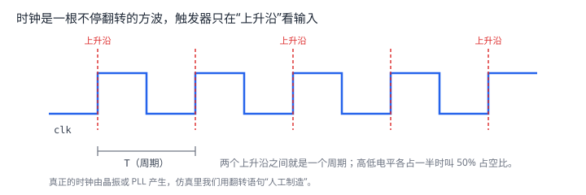
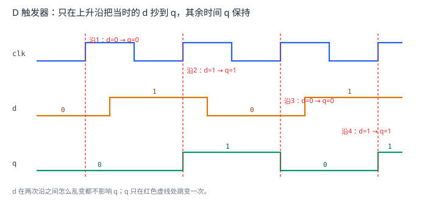
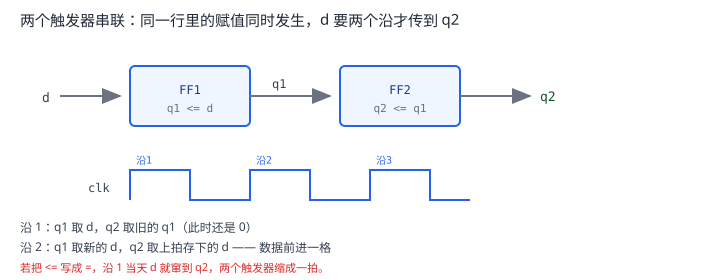
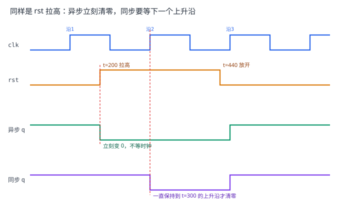

# 12 时钟与触发器

> 阶段 4 的第二篇。这一篇引入时钟，电路第一次拥有“记忆”。前面所有电路都是“输入变、输出立刻变”，从这篇开始，输出只在时钟沿更新。

## 1. 时钟是什么

一根不停翻转的方波：



| 术语 | 含义 |
|---|---|
| 周期 T | 两个上升沿之间的时间 |
| 频率 f | `f = 1/T`，100 MHz 就是每秒 1 亿个周期 |
| 上升沿 | 电平从 0 跳到 1 的那一瞬间 |
| 占空比 | 高电平占一个周期的比例，50% 表示高低各一半 |

触发器**只在上升沿那一瞬间**看输入、更新输出，其余时间输出保持不变。这个“只看瞬间”的特性，让整块电路能按统一的节奏工作。

## 2. D 触发器

最简单的时序单元：一个输入 `d`，一个输出 `q`，一个时钟。

```
         ┌─────────┐
   d ───►│    D    │
         │   FF    ├───► q
  clk ──►│         │
         └─────────┘
```

规则：**上升沿到来时，q 变成此刻的 d**；其他时间 q 不变。



看图能得到两个结论：

1. `d` 在两次上升沿之间怎么变，都不影响 `q`
2. `q` 只会在红色虚线处跳变，且跳变后的值等于那一刻的 `d`

## 3. 语法

```verilog
always @(posedge clk) begin
    q <= d;
end
```

| 部分 | 含义 |
|---|---|
| `always` | 过程块 |
| `@(posedge clk)` | 只在 clk 的**上升沿**执行 |
| `<=` | 非阻塞赋值，时序逻辑专用 |
| `q` | 必须声明为 `reg`（这里是真正的寄存器） |

和组合逻辑对照：

| | 组合逻辑 | 时序逻辑 |
|---|---|---|
| 写法 | `always @(*)` | `always @(posedge clk)` |
| 触发 | 任何输入变化 | 只在时钟上升沿 |
| 赋值 | `=` | `<=` |
| 综合结果 | 门电路 | 触发器 |

## 4. 为什么时序逻辑必须用 `<=`

看两个触发器串联：



```verilog
always @(posedge clk) begin
    q1 <= d;
    q2 <= q1;
end
```

`<=` 的规则：**块内所有语句右边的值，在更新前统一读取**。所以同一个沿上，`q2` 读到的是**更新前的 q1**，两个触发器各前进一格。

| 时刻 | q1 | q2 |
|---|---|---|
| 初始 | 0 | 0 |
| 沿 1（d=1） | 1 | 0 |
| 沿 2（d=1） | 1 | 1 |

`d` 的 1 需要**两个沿**才到达 `q2`，这就是移位寄存器。

如果改成阻塞赋值：

```verilog
q1 = d;      // 立刻变成新值
q2 = q1;     // 读到的是刚更新的 q1
```

沿 1 当天 `d` 就窜到 `q2`，两拍压缩成一拍。仿真看起来“也能动”，但和真实硬件不一致——真实触发器不可能在同一个沿里串联传递。

**结论**：`<=` 是用来模拟“多个触发器同时更新”的，时序逻辑必须用它。

## 5. 复位

触发器上电时输出是未知的 `x`。未知值参与运算还是未知值，整个电路就废了。所以每个触发器都要有一个“确定起点”，这就是复位。

### 5.1 先看两种写法的差别

**同步复位**：复位信号要等时钟沿才生效。

```verilog
always @(posedge clk) begin      // always：过程块，重复执行
                                 // @(posedge clk)：唤醒条件——只有 clk 从 0 变 1 的瞬间才执行一次
                                 // begin：块体开始（块里只有一条语句时也可以省略）
    if (rst) q <= 1'b0;          // if (rst)：在“沿”这一刻检查 rst 是高还是低
                                 // rst 为 1 → 执行这一行：q 取 0
                                 // 1'b0：1 位、二进制、值是 0
                                 // <=：非阻塞赋值，本拍所有语句走完后统一写入 q
    else     q <= d;             // else：rst 为 0 时才走这里
                                 // d：输入数据（在计数器例子里，d 就是 q + 1'b1）
                                 // 于是“复位时清零、平时存输入”两个动作互斥，不会同时发生
end                              // end：块体结束，与 begin 配对
```

**异步复位**：`rst` 一拉高立刻清零，不看时钟。

```verilog
always @(posedge clk or posedge rst) begin   // 敏感列表里用 or 连接两个事件
                                             // posedge clk：时钟上升沿
                                             // or：或者——两个事件任意一个发生都执行
                                             // posedge rst：rst 从 0 变 1 的瞬间也执行
                                             // 所以 rst 拉高不用等时钟，块当场被唤醒
    if (rst) q <= 1'b0;                      // 被 rst 唤醒时 rst 一定为 1，因此直接清零
                                             // 被 clk 唤醒时，如果 rst 恰好也是 1，同样清零
                                             // <=：仍然用非阻塞，保持“沿上统一更新”的语义
    else     q <= d;                         // 只有 rst 为 0 才存输入
                                             // 若 rst 为 1，这一行被跳过，复位拥有最高优先级
end                                          // 结束块体
```

两段代码只差敏感列表一处，行为差别在于“谁有资格唤醒这个块”：

| 场景 | 同步复位 | 异步复位 |
|---|---|---|
| rst 在两拍之间拉高 | 块不被唤醒，q 不变 | 块立刻执行，q 清零 |
| clk 上升沿到来时 rst=1 | 执行清零 | 执行清零 |
| 时钟完全停摆时按复位 | 无法复位 | 正常复位 |

> 这两段是触发器的通用模板。`counter4.v` 用的是同步版，只把 `d` 换成了 `q + 1'b1`；`counter4_async.v` 是异步版，与你上面看到的第一段、第二段逐行对应。



同样在 t=200 拉高 `rst`：

- 异步版：q 在 t=200 当场变 0
- 同步版：q 一直保持，直到 t=300 的上升沿才变 0

### 5.2 逐词拆解敏感列表

| 写法 | 逐词解释 |
|---|---|
| `always` | 一个过程块，“只要下面列出的事件发生，就执行一次” |
| `@(...)` | 事件列表，括号里写“什么情况下唤醒这个块” |
| `posedge clk` | `posedge` = 上升沿；`clk` 从 0 变 1 的瞬间触发 |
| `or` | “或者”。**两个事件任意一个发生，都会执行** |
| `posedge rst` | `rst` 从 0 变 1 的瞬间也触发 |
| `begin ... end` | 块体 |

所以 `@(posedge clk or posedge rst)` 读作：**时钟上升沿、或者复位上升沿，任意一个来了就执行一次**。

对比 `@(posedge clk)`：只有时钟沿能唤醒，`rst` 自己怎么变都不触发，只能等下一个时钟沿被“顺便”读到。

### 5.3 `if (rst)` 为什么必须写在最前面

```verilog
always @(posedge clk or posedge rst) begin
    if (rst) q <= 4'd0;      // 第一优先级：复位
    else     q <= q + 1'b1;  // 只有没复位时才正常工作
end
```

`begin ... end` 里的语句按顺序执行，`if` 写在最前面，复位就拥有最高优先级——只要 `rst` 为高，计数逻辑根本不执行。

写成 `else` 而不是再写一个 `if`，也是为了让“复位”和“正常工作”互斥，不会同时发生。

### 5.4 实测对比

两个计数器的代码只差敏感列表一处，其余完全相同：

| 文件 | 敏感列表 |
|---|---|
| `counter4.v` | `always @(posedge clk)` |
| `counter4_async.v` | `always @(posedge clk or posedge rst)` |

测试台故意把 `rst` 拉高的时刻选在**两个上升沿之间**（t=38）：

```powershell
cd C:\Users\19918\Documents\verilog-lab\01_basics\sequential
iverilog -o reset.vvp counter4.v counter4_async.v reset_compare_tb.v
vvp reset.vvp
```

真实输出：

```
---- t=36  复位前 ----
  同步 q=3   异步 q=3
---- t=41  rst 拉高后（无时钟沿）----
  同步 q=3   异步 q=0   ← 异步立刻清零
---- t=57  复位放开后 ----
  同步 q=1   异步 q=1
```

t=41 的时候还没有出现过任何时钟沿，同步版仍然停在 3，异步版已经是 0——这就是两种复位的唯一差别。

### 5.5 复位释放的坑

异步复位有个隐患：如果 `rst` **恰好在一个时钟沿附近放开**，触发器可能进入亚稳态（输出在一段时间内既不是 0 也不是 1）。

工程上的标准做法叫**异步复位、同步释放**：

```verilog
// 复位本身是异步的（rst 拉高立刻生效）
// 但释放要经过两级触发器同步到时钟域
always @(posedge clk or posedge rst) begin
    if (rst) begin
        rst_sync1 <= 1'b1;
        rst_sync2 <= 1'b1;
    end
    else begin
        rst_sync1 <= 1'b0;
        rst_sync2 <= rst_sync1;
    end
end
```

这个结构等后面做 UART 项目时再展开，现在只要知道：**复位不是“接上就行”，释放时机有讲究**。

### 5.6 对比表

| | 同步复位 | 异步复位 |
|---|---|---|
| 敏感列表 | `posedge clk` | `posedge clk or posedge rst` |
| 生效时机 | 下一个时钟沿 | 立刻 |
| 时钟没起来时 | 无法复位 | 仍然能复位 |
| 时序分析 | 简单 | 需要额外约束 |
| 风险 | 需要时钟先跑起来 | 释放时可能亚稳态 |
| 工程用法 | 逻辑简单时可用 | 配“同步释放”使用 |

现阶段练习用同步复位就够，行为最容易观察；做项目时再换成“异步复位、同步释放”。

## 6. 例子：4 位计数器

```verilog
module counter4 (
    input           clk,
    input           rst,
    output reg [3:0] q
);

    always @(posedge clk) begin
        if (rst) q <= 4'd0;
        else     q <= q + 1'b1;
    end

endmodule
```

几个点：

- `q + 1'b1` 在 4 位里加到 15 再加就溢出回 0，自然形成 0~15 循环
- `q` 是 `output reg`，因为它被 `always` 赋值
- 它同时也是**分频器**：`q[0]` 每 2 个周期翻转，`q[3]` 每 16 个周期翻转一次

这个“分频”特性是后面做数码管扫描、蜂鸣器发声的基础。

## 7. 测试台怎么产生时钟

时钟在仿真里要自己造：

```verilog
initial begin
    clk = 1'b0;
    forever #5 clk = ~clk;    // 每 5 个单位翻转，周期 10
end
```

`forever` 是死循环，靠另一个 `initial` 块结束：

```verilog
initial begin
    rst = 1'b1;
    #22;          // 跨过 t=20 的上升沿
    rst = 1'b0;   // 放开复位
    #178;
    $finish;
end
```

**两个 `initial` 是并行执行的**：一个不停翻时钟，一个负责复位和停机。

### 打印时为什么要等 1 个单位

```verilog
always @(posedge clk) begin
    #1;
    $display("t=%0t q=%d", $time, q);
end
```

打印块和计数器块都在上升沿触发，同一时刻谁先执行**没有保证**。不等就会打印出更新前的旧值，仿真开头甚至直接看到 `x`。加 `#1` 让 q 先更新完，读到的才是稳定值。

这也是时序仿真和组合仿真最大的不同：**同一时刻的动作有先后问题**。

## 8. 常见错误

| 现象 | 原因 | 修法 |
|---|---|---|
| 开头全是 `x` | 没写复位 | 加 `rst` 并正确初始化 |
| q 每个沿变化两次 | 用了 `=` | 时序逻辑改 `<=` |
| 打印值总是差一拍 | 同刻读写竞争 | 打印前 `#1` |
| 综合报“组合环” | 在 `always @(*)` 里自赋值 | 自赋值只能出现在时钟块 |
| 复位不起作用 | 复位和时钟沿同刻 | 让复位避开时钟沿 |

## 9. 源码与运行

| 文件 | 内容 |
|---|---|
| `01_basics/sequential/counter4.v` | 4 位同步复位计数器 |
| `01_basics/sequential/counter4_tb.v` | 时钟发生器 + 复位 + 每沿打印 |
| `01_basics/sequential/counter4_async.v` | 4 位异步复位计数器（只差敏感列表） |
| `01_basics/sequential/reset_compare_tb.v` | 两种复位并排对比，在无时钟沿时观察差别 |

**计数器演示**：

```powershell
cd C:\Users\19918\Documents\verilog-lab\01_basics\sequential
iverilog -o counter4.vvp counter4.v counter4_tb.v
vvp counter4.vvp
```

**复位对比**：

```powershell
iverilog -o reset.vvp counter4.v counter4_async.v reset_compare_tb.v
vvp reset.vvp
```

计数器实测输出（节选）：

```
t=6 ns  rst=1  q= 0 (0000)
t=16 ns  rst=1  q= 0 (0000)
t=26 ns  rst=0  q= 1 (0001)
t=36 ns  rst=0  q= 2 (0010)
...
t=166 ns rst=0  q=15 (1111)
t=176 ns rst=0  q= 0 (0000)     ← 溢出回 0
t=186 ns rst=0  q= 1 (0001)
counter4_tb.v:39: $finish called at 200 (1s)
```

## 10. 小结

1. 时钟是方波，触发器只在上升沿工作
2. `always @(posedge clk)` + `<=` 描述的才是真正的寄存器
3. `<=` 让同一块内的赋值同时生效，这样才能级联多位触发器
4. 触发器必须复位，否则初值是 `x`
5. 测试台要自己造时钟，注意同刻读写的竞争

下一篇是阶段 4 的最后一篇：**有限状态机**，把计数器、选择器、触发器组合起来，做成“会按步骤做事”的电路——UART、SPI、CPU 控制器都靠它。
