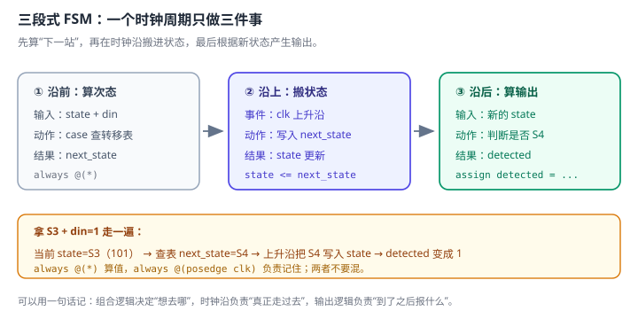
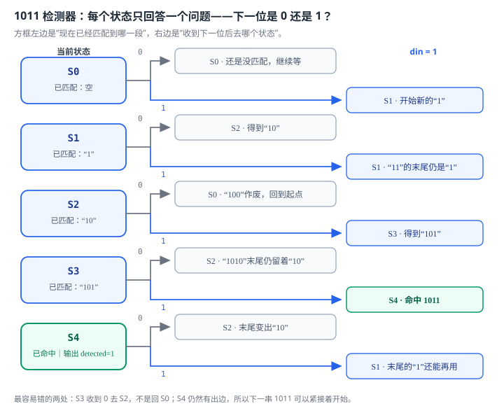
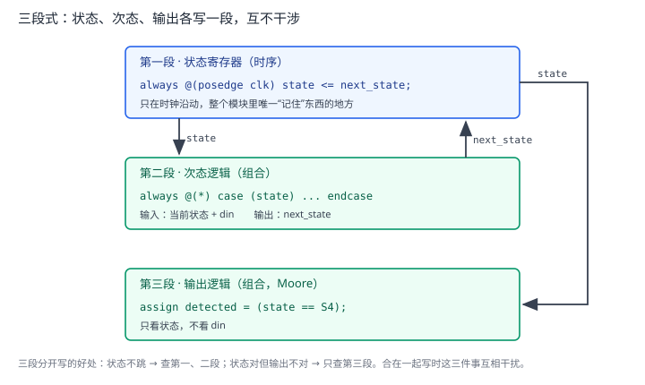

# 13 有限状态机

> 状态机不是新语法，而是一种组织代码的方法：**用寄存器记住“做到哪一步”，再用输入决定“下一步去哪”。**

---

## 1. 先把三个词分清

| 名字 | 作用 | 在代码里 |
|---|---|---|
| 状态 `state` | 记录当前进度 | 真正的寄存器，只在时钟沿更新 |
| 次态 `next_state` | 记下“下一步该去哪” | 组合逻辑算出来的值，不记忆 |
| 转移 | `当前状态 + 输入 → 次态` | 一张表，用 `case` 描述 |

读代码时只抓这条线：

```text
当前 state + 当前 din  →  查表得到 next_state  →  时钟沿写入 state  →  产生输出
```



一句话记：**组合逻辑决定“想去哪”，时钟沿负责“真正走过去”。**

---

## 2. 1011 检测器的状态怎么定

目标：输入一位一位来，连续出现 `1011` 时输出 1。允许重叠，例如：

```text
1011011
└─┬─┘
  └─┬─┘
```

中间那个 `1` 被两次使用，所以叫“可重叠”。

状态表示“目前最多匹配到了目标串的哪一段”：

| 状态 | 已经匹配 | 含义 |
|---|---|---|
| S0 | 空 | 什么都没匹配到 |
| S1 | `1` | 手里有用的后缀是 `1` |
| S2 | `10` | 手里有用的后缀是 `10` |
| S3 | `101` | 手里有用的后缀是 `101` |
| S4 | `1011` | 刚刚命中，输出 1 |

每个状态只需要回答一个问题：**下一位 `din` 是 0 还是 1？**



想逐拍点着看，可以打开[状态机交互演示](assets/fsm1011-demo.html)。

最容易错的两处：

| 情况 | 正确次态 | 为什么 |
|---|---|---|
| S3 收到 0 | S2 | `1010` 的末尾是 `10`，还可以继续用 |
| S4 收到 0 / 1 | S2 / S1 | 命中后输入流没停，末尾还能作为下一轮开头 |

> 规则可以概括成一句：把“手里的串 + 新位”拼起来，只保留仍能作为 `1011` 前缀的最长后缀。

---

## 3. 三段式代码

把三件事分开写，出错时更容易定位：

| 段 | 管什么 | 关键写法 |
|---|---|---|
| 第一段 | 记住状态 | `always @(posedge clk)`，用 `<=` |
| 第二段 | 算下一站 | `always @(*)`，用 `=` |
| 第三段 | 产生输出 | `assign`，Moore 只看 `state` |



### 第一段：状态寄存器

```verilog
always @(posedge clk) begin
    if (rst)
        state <= S0;         // 复位：回到起点
    else
        state <= next_state; // 正常：把下一站搬进来
end
```

这一段**不计算转移**，只负责在上升沿“记住”第二段算好的结果。

### 第二段：次态逻辑

```verilog
always @(*) begin
    next_state = state;      // 默认保持，防止漏分支产生锁存器

    case (state)
        S0: begin
            if (din) next_state = S1; // 1 → 开始匹配
            else     next_state = S0; // 0 → 继续等
        end

        S1: begin
            if (din) next_state = S1; // 11 → 末尾仍是 1
            else     next_state = S2; // 10
        end

        S2: begin
            if (din) next_state = S3; // 101
            else     next_state = S0; // 100 → 作废
        end

        S3: begin
            if (din) next_state = S4; // 1011 → 命中
            else     next_state = S2; // 1010 → 末尾留着 10
        end

        S4: begin
            if (din) next_state = S1; // 10111 → 末尾留着 1
            else     next_state = S2; // 10110 → 末尾留着 10
        end

        default: next_state = S0;     // 未定义编码统一回起点
    endcase
end
```

理解 `case` 的角度：

- `case (state)` 选的是“当前在哪一行”
- 里面的 `if (din)` 选的是“这一行的 0 列还是 1 列”
- 每个 `begin ... end` 都写清两条路，所以不会漏

### 第三段：输出逻辑

```verilog
assign detected = (state == S4);
```

这是 **Moore 型**：输出只看状态。

- `state = S4` → `detected = 1`
- `state` 离开 S4 → `detected` 自动变回 0

### 两条不能混的规则

| 规则 | 原因 |
|---|---|
| `state` 用 `<=`，`next_state` 用 `=` | 前者是寄存器；后者是组合逻辑 |
| `next_state = state;` 放最前面 | 保证任何路径都有默认赋值 |

完整带注释源码：[`01_basics/fsm/seq_detect1011.v`](../01_basics/fsm/seq_detect1011.v)

---

## 4. 一个时钟沿到底发生了什么

假设现在是 `S3`，输入 `din=1`：

| 顺序 | 正在发生什么 | 值 |
|---|---|---|
| ① 沿前 | 第二段用旧状态查表 | `state=S3`，`next_state=S4` |
| ② 上升沿 | 第一段把次态搬进状态 | `state: S3 → S4` |
| ③ 沿后 | 第三段根据新状态产生输出 | `detected: 0 → 1` |

所以：

- **组合逻辑没有“记忆”**，它只是根据当前输入不停重算
- **只有第一段会记住东西**
- Moore 要等状态进入 S4 才输出 1；Mealy 在 `S3 && din` 当拍就能输出，见 [14 Moore 与 Mealy](14-Moore与Mealy.md)

---

## 5. 跟着输入流走一遍

输入流：`1011 0110 1011`

```text
输入:   1   0   1   1   0   1   1   0   1   0   1   1
        │   │   │   │   │   │   │   │   │   │   │   │
采样后: S1  S2  S3  S4  S2  S3  S4  S2  S3  S2  S3  S4
                    ↑               ↑           ↑
                 第1次命中        第2次命中    第3次命中
```

中间两段要特别看：

| 片段 | 结果 |
|---|---|
| `1011` 后接 `011` | 第 1 个 `1011` 的最后一个 `1` 又是第 2 个的开头 |
| `1010` | 最后一位是 0，不是命中；但状态退回 S2，保留了 `10` |
| `1010` 后接 `11` | S2 → S3 → S4，形成第 3 次命中 |

---

## 6. 出问题时查哪一段

| 现象 | 先查 |
|---|---|
| 状态一直是 `xxx` | 第一段：复位有没有先拉高，时钟有没有跑 |
| 状态完全不动 | 第一段：`posedge clk` 是否写对 |
| 状态跳错 | 第二段：拿着状态表逐行对 `din` |
| 状态对但输出错 | 第三段：是否写成 `state == S4` |
| 多报一次或少报一次 | 重叠规则：S3/S4 的 0/1 分支是否写反 |
| 综合出锁存器 | 第二段是否有分支没赋值，或漏了默认值 |

---

## 7. 运行

```powershell
cd C:\Users\19918\Documents\verilog-lab\01_basics\fsm
iverilog -o fsm.vvp seq_detect1011.v seq_detect1011_mealy.v seq_detect_tb.v
vvp fsm.vvp
```

期望最后两行：

```text
Moore 命中 3 次，Mealy 命中 3 次
PASS：两个版本都检出 3 次 1011
```

---

## 8. 小结

1. 状态 = 有用的历史压缩成几个值
2. 次态 = 当前状态 + 当前输入查表的结果
3. 三段式：**沿前算、沿上搬、沿后输出**
4. `case (state)` 管“当前在哪”，分支里的 `din` 管“往哪走”
5. Moore 输出只看状态，Mealy 输出还看输入

下一篇：[14 Moore 与 Mealy](14-Moore与Mealy.md)