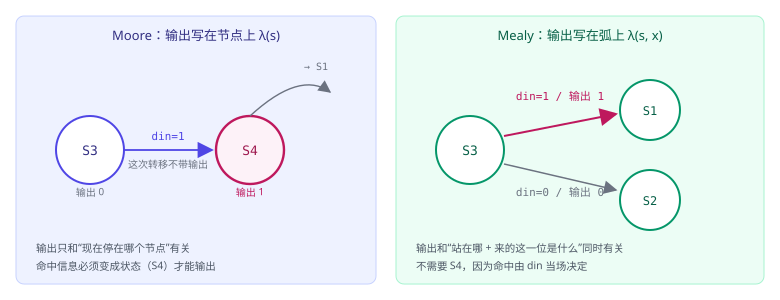
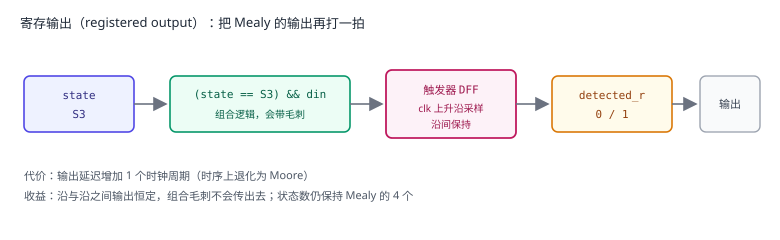
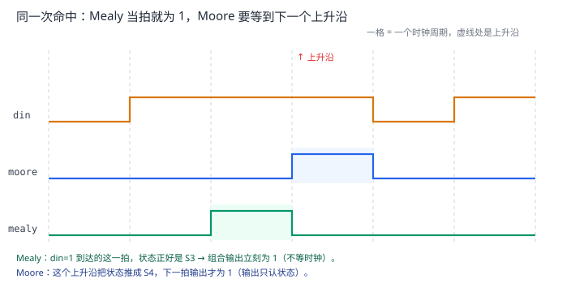

# 14 Moore 型与 Mealy 型

> 同样一个功能，输出函数可以有两种定义方式，由此产生两类状态机。差别不在写法，在**输出函数依赖谁**。

---

## 1. 定义：区别只有一处

状态机五元组 `M = (S, Σ, δ, λ, s0)` 中，两种类型的差别全在输出函数 λ 的定义域：

| 类型 | 输出函数 | 读法 | 出处 |
|---|---|---|---|
| Moore | `λ: S → Y` | 输出只由**状态**决定 | Edward F. Moore, 1956 |
| Mealy | `λ: S × Σ → Y` | 输出由**状态和当前输入**共同决定 | George H. Mealy, 1955 |

形式化写出来：

```
Moore ：y(t) = λ( s(t) )
Mealy ：y(t) = λ( s(t), x(t) )
```

`s(t)` 是当前状态，`x(t)` 是当前输入，`y(t)` 是输出。注意两者都以状态为参数，区别只在**有没有 `x(t)`**。



---

## 2. 对同一规格，两种实现的差别

以 1011 检测为例（允许重叠）：

| | Moore | Mealy |
|---|---|---|
| 状态集合 S | {S0,S1,S2,S3,S4}，**5 个** | {S0,S1,S2,S3}，**4 个** |
| 编码位宽 | 3 位 | 2 位 |
| 输出条件 | `state == S4` | `state == S3 && din` |
| 输出出现在 | 命中后的下一个时钟周期 | 命中的同一个时钟周期 |

### 为什么 Mealy 少一个状态

Moore 的输出函数看不见输入，所以"刚刚命中"这件事只能**存进状态**——必须有 S4。

Mealy 的输出函数带 `din`，`(S3, din=1)` 这个组合本身就编码了"命中"，不需要额外状态。

这就是 Mealy 型在状态数上的优势：**把"最后一步判断"从状态转移到了转移弧上**。

### 转移表的形式差异

Moore 表的每一行末尾有一个输出列：

| 状态 | din=0 | din=1 | 输出 |
|---|---|---|---|
| S0 | S0 | S1 | 0 |
| S1 | S2 | S1 | 0 |
| S2 | S0 | S3 | 0 |
| S3 | S2 | S4 | 0 |
| S4 | S2 | S1 | **1** |

Mealy 表没有输出列，**每个格子自带一个输出**：

| 状态 | din=0（次态 / 输出） | din=1（次态 / 输出） |
|---|---|---|
| S0 | S0 / 0 | S1 / 0 |
| S1 | S2 / 0 | S1 / 0 |
| S2 | S0 / 0 | S3 / 0 |
| S3 | S2 / 0 | **S1 / 1** |

这张表一眼能看出：**Mealy 的输出写在弧上，Moore 的输出写在节点上**。状态转移图里也是这个画法——Moore 图节点旁边标输出，Mealy 图弧上标 `输入/输出`。


---

## 3. 怎么实现

### 3.1 Moore：三段 + 组合输出

```verilog
// 第一段：状态寄存器
always @(posedge clk) begin
    if (rst) state <= S0;
    else     state <= next_state;
end

// 第二段：次态函数 δ
always @(*) begin
    next_state = state;
    case (state)
        S0: next_state = din ? S1 : S0;
        S1: next_state = din ? S1 : S2;
        S2: next_state = din ? S3 : S0;
        S3: next_state = din ? S4 : S2;
        S4: next_state = din ? S1 : S2;
        default: next_state = S0;
    endcase
end

// 第三段：输出函数 λ(s)，只依赖状态
assign detected = (state == S4);
```

### 3.2 Mealy：三段 + 组合输出

```verilog
// 第一、二段同上，只是没有 S4

// 第三段：输出函数 λ(s, x)，多了一个 din
assign detected = (state == S3) && din;
```

两段代码的第三段就是 λ 的直接翻译：**λ 有哪些参数，右边就有哪些信号**。

### 3.3 专业的第四种写法：寄存输出（registered output）

Mealy 的输出是组合逻辑，会带毛刺。工程上常把它**再打一拍**：

```verilog
reg detected_r;
always @(posedge clk) begin
    detected_r <= (state == S3) && din;   // 输出也进寄存器
end
assign detected = detected_r;
```

注意：**打完这一拍，输出延迟就退化成 Moore 了**。所以"寄存输出的 Mealy"在时序上等价于 Moore，只是在状态编码上仍然省一个状态。这是 FPGA 设计里非常常见的折中。



---

## 4. 时序特性对比

| 维度 | Moore | Mealy |
|---|---|---|
| 输出延迟（周期） | ≥ 1（状态先更新） | 0（组合直通） |
| 关键路径 | 状态→输出，短 | 输入→输出，可能很长 |
| 输出毛刺 | 无（若状态由触发器驱动） | 有，输入抖动直接传导 |
| 状态数 | 多 | 少 |
| 对输入变化的敏感度 | 不敏感 | 敏感 |
| 时序分析 | 简单 | 需要约束 input→output 路径 |

### 关于毛刺

Mealy 输出 `(state == S3) && din` 是一个**组合逻辑**。`din` 在两次时钟沿之间可能多次变化（比如按键抖动、总线上的过渡态），每次变化都会立即出现在输出上。

Moore 输出 `(state == S4)` 只依赖状态，而状态由触发器驱动，只在时钟沿改变——所以沿与沿之间输出恒定。



真实系统中这个差别很致命：如果输出直接接另一个模块的使能端，Mealy 的毛刺可能被误采。

---

## 5. 怎么选

| 场景 | 推荐 | 理由 |
|---|---|---|
| 输出接另一个时序模块的使能/握手 | Moore 或寄存输出的 Mealy | 避免毛刺被采 |
| 追求最小延迟（如高速接口采样） | Mealy | 当拍输出 |
| 状态数敏感、资源受限 | Mealy | 少一个状态、少一位编码 |
| 教学、可读性优先 | Moore | 输出与状态一一对应，好调试 |
| 安全关键设计 | Moore | 输出确定、时序可分析 |

---

## 6. 两种类型可以互相转换

**Moore → Mealy**：把"输出为 1 的那个状态"合并回它的入弧。

```
Moore：S3 --din=1--> S4（输出 1）
Mealy：S3 --din=1/输出 1--> S1
```

状态数减少 1，输出提前一拍。

**Mealy → Moore**：把弧上的输出拆出来，新建一个状态专门表示"输出有效"。

```
Mealy：S3 --din=1/1--> S1
Moore：S3 --din=1--> S4（输出 1）--任意--> S1
```

状态数增加，输出延后一拍。

两者表达能力完全相同：**任何 Mealy 机都存在等价的 Moore 机，反之亦然**（状态数可以不同）。所以选型不是"能不能"，而是"代价哪个小"。

---

## 7. 本仓库的实测

| 版本 | 文件 | 命中时机（同一输入流） |
|---|---|---|
| Moore | `seq_detect1011.v` | t=60 输出变 1（状态到 S4 之后） |
| Mealy | `seq_detect1011_mealy.v` | t=50 输出变 1（S3 遇到 din=1 当拍） |

相差正好一个时钟周期（10 个时间单位），可以在测试台输出里逐行对照：

```
t=50 ns  din=1  state=011  moore=0  mealy=1
t=60 ns  din=1  state=100  moore=1  mealy=0
```

同一个 `1011`，Mealy 在 t=50 就报，Moore 要等 t=60 状态变成 S4。

```powershell
cd C:\Users\19918\Documents\verilog-lab\01_basics\fsm
iverilog -o fsm.vvp seq_detect1011.v seq_detect1011_mealy.v seq_detect_tb.v
vvp fsm.vvp
```

---

## 8. 术语表

| 术语 | 含义 |
|---|---|
| 状态转移函数 δ | `S × Σ → S`，决定下一个状态 |
| 输出函数 λ | Moore 为 `S → Y`，Mealy 为 `S × Σ → Y` |
| 组合输出 | 输出直接由组合逻辑产生，随输入瞬时变化 |
| 寄存输出 | 输出额外经过一级触发器，延迟一拍、无毛刺 |
| 毛刺（glitch） | 组合逻辑在输入变化瞬间产生的窄脉冲 |
| 关键路径 | 两个触发器之间最长的组合延迟，决定最高时钟频率 |
| 输入到输出路径 | Mealy 特有的时序路径，需要额外约束 |

---

## 9. 小结

1. 定义差别只有一处：**λ 的定义域有没有输入**
2. 图上表现：Moore 输出写在节点，Mealy 输出写在弧
3. 代价差别：Mealy 少状态、快一拍，但输出是组合逻辑，带毛刺
4. 实现差别：第三段右式里有没有 `din`
5. 工程折中：寄存输出的 Mealy = 时序像 Moore，状态数像 Mealy
