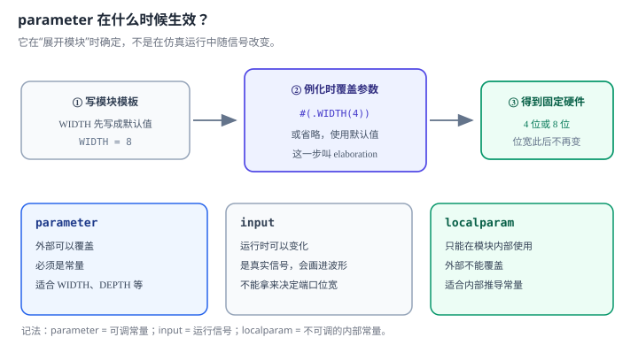
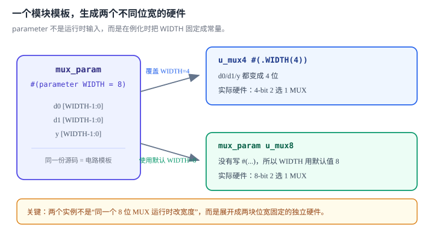

# 15 参数化模块

> `parameter` 是模块展开时传入的**常量**。它让同一份 Verilog 源码生成不同位宽、不同深度的硬件。

---

## 1. `parameter` 是什么

先记住一句话：

> **`input` 是运行时信号；`parameter` 是展开电路时固定下来的常量。**

| 名字 | 什么时候确定 | 能不能改 | 会不会出现在波形里 |
|---|---|---|---|
| `parameter` | 例化 / 展开模块时 | 例化时可以覆盖 | 不会，它不是信号 |
| `input` | 仿真运行时 | 随时可能变化 | 会 |
| `localparam` | 模块内部展开时 | 外部不能覆盖 | 不会 |

最常见的参数是位宽：

```verilog
parameter WIDTH = 8;
```

它的意思不是“WIDTH 这个信号现在等于 8”，而是：

> 这个模块被展开时，把所有 `WIDTH` 都替换成常量 8。



---

## 2. 一个模板，两个实例

下面这个 MUX 不写死 4 位或 8 位，只写 `WIDTH`：

```verilog
module mux_param #(
    parameter WIDTH = 8       // 默认 8 位，例化时可以覆盖
) (
    input  [WIDTH-1:0] d0,    // 宽度由 WIDTH 决定
    input  [WIDTH-1:0] d1,
    input              sel,
    output [WIDTH-1:0] y
);

    assign y = sel ? d1 : d0;

endmodule
```

`WIDTH-1:0` 的意思是：

- `WIDTH=8` → `[7:0]`，8 位
- `WIDTH=4` → `[3:0]`，4 位



---

## 3. 例化时怎么覆盖参数

### 3.1 使用默认值

```verilog
mux_param u_mux8 (
    .d0(d0_8),
    .d1(d1_8),
    .sel(sel),
    .y(y_8)
);
```

没有写 `#(...)`，所以使用默认的 `WIDTH=8`。

### 3.2 覆盖成 4 位

```verilog
mux_param #(
    .WIDTH(4)          // 参数覆盖列表
) u_mux4 (
    .d0(d0_4),
    .d1(d1_4),
    .sel(sel),
    .y(y_4)
);
```

逐词看：

| 写法 | 含义 |
|---|---|
| `#(...)` | 参数覆盖列表，必须写在实例名前面 |
| `.WIDTH(4)` | 把本实例的 `WIDTH` 设成常量 4 |
| `u_mux4` | 这个实例自己的名字 |
| `(...)` | 普通端口连接 |

所以同一个 `mux_param`：

- `u_mux4` 展开成 4 位 MUX
- `u_mux8` 展开成 8 位 MUX

**这不是运行时把 8 位改成 4 位，而是生成两块不同的硬件。**

> 注意：`WIDTH` 必须是展开时能算出的常量，不能传 `sel`、`counter` 这类运行时信号。

---

## 4. 完整示例

| 文件 | 作用 |
|---|---|
| [`mux_param.v`](../01_basics/advanced/mux_param.v) | 参数化 2 选 1 MUX |
| [`mux_param_tb.v`](../01_basics/advanced/mux_param_tb.v) | 同时测试 4 位和 8 位实例 |

运行：

```powershell
cd C:\Users\19918\Documents\verilog-lab\01_basics\advanced
iverilog -o mux_param.vvp mux_param.v mux_param_tb.v
vvp mux_param.vvp
```

实测输出：

```text
WIDTH=4  sel=0  y=1010
WIDTH=8  sel=0  y=10100101
PASS: sel=0 输出正确
WIDTH=4  sel=1  y=0101
WIDTH=8  sel=1  y=01011010
PASS: sel=1 输出正确
```

---

## 5. 常见错误

| 现象 | 原因 |
|---|---|
| 端口位宽对不上 | 测试台信号位宽和 `WIDTH` 不一致 |
| 参数没生效 | `#(.WIDTH(...))` 写在了实例名后面，或漏了 `#` |
| 报“不是常量” | 给参数传了 `sel`、`counter` 这类运行时信号 |
| 以为参数是输入 | `parameter` 不属于端口表，不会被综合成一根信号线 |
| 想从外部改 `localparam` | `localparam` 只能在模块内部使用 |

---

## 6. 小结

1. `parameter` 是展开模块时的常量
2. 默认值写在模块声明里，例化时可用 `#(.名字(值))` 覆盖
3. 同一份源码可以生成不同位宽的独立硬件
4. `parameter` 不能接运行时信号
5. `localparam` 是外部不能覆盖的内部常量

下一篇：用 `generate for` 批量生成重复结构。
