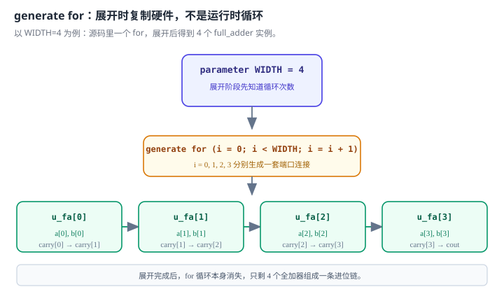

# 16 generate for

> `generate for` 是**展开硬件时的循环**。它把一段实例化代码复制 WIDTH 次，不是仿真运行时反复执行。

---

## 1. 它解决什么问题

前面写 4 位加法器时，手工放了 4 个全加器：

```verilog
full_adder u0 (...);
full_adder u1 (...);
full_adder u2 (...);
full_adder u3 (...);
```

如果改成 8 位、16 位，就要继续复制。`generate for` 让这件事自动完成。



一句话：

> **普通 `for` 在仿真运行时循环；`generate for` 在展开模块时复制硬件结构。**

---

## 2. 语法骨架

```verilog
genvar i;                 // 只用于 generate 展开的循环变量

generate
    for (i = 0; i < WIDTH; i = i + 1) begin : gen_name
        // 这里放需要重复的实例化
    end
endgenerate
```

| 部分 | 含义 |
|---|---|
| `genvar i` | 生成硬件时的循环变量，不是寄存器 |
| `generate ... endgenerate` | 生成块范围 |
| `begin : gen_name` | 给这一组生成实例一个层级名 |
| `i < WIDTH` | 循环次数通常由 `parameter` 决定 |

`WIDTH=4` 时，循环会依次展开成 `i=0、1、2、3` 四套硬件。

---

## 3. 参数化行波加法器

核心代码：

```verilog
module adder_param #(
    parameter WIDTH = 4
) (
    input  [WIDTH-1:0] a,
    input  [WIDTH-1:0] b,
    input              cin,
    output [WIDTH-1:0] sum,
    output             cout
);

    wire [WIDTH:0] carry;    // 比数据多一位，用来保存最高位进位

    assign carry[0] = cin;   // 进位链起点

    genvar i;
    generate
        for (i = 0; i < WIDTH; i = i + 1) begin : gen_full_adders
            full_adder u_fa (
                .a(a[i]),
                .b(b[i]),
                .cin(carry[i]),
                .sum(sum[i]),
                .cout(carry[i+1])
            );
        end
    endgenerate

    assign cout = carry[WIDTH];

endmodule
```

重点看进位：

```text
carry[0] = cin
carry[1] = 第 0 位的 cout
carry[2] = 第 1 位的 cout
……
carry[WIDTH] = 最高位的 cout
```

`carry` 必须声明成 `[WIDTH:0]`，也就是比 `a/b/sum` 多一位；否则最高位进位没有地方放。

---

## 4. 两个实例和源码

```verilog
adder_param #(.WIDTH(4)) u_add4 (...); // 展开 4 个全加器
adder_param #(.WIDTH(8)) u_add8 (...); // 展开 8 个全加器
```

源码：[`adder_param.v`](../01_basics/advanced/adder_param.v) 和 [`adder_param_tb.v`](../01_basics/advanced/adder_param_tb.v)。

---
## 5. 运行

```powershell
cd C:\Users\19918\Documents\verilog-lab\01_basics\advanced
iverilog -o adder_param.vvp ../modules/half_adder.v ../modules/full_adder.v adder_param.v adder_param_tb.v
vvp adder_param.vvp
```

实测输出：

```text
4-bit  3 + 5 = 8, cout=0
8-bit A5 + 5A = ff, cout=0
PASS: 普通加法结果正确
4-bit  F + 1 + 1 = 1, cout=1
8-bit A5 + 6A + 1 = 10, cout=1
PASS: 进位结果正确
```

`F + 1 + 1` 的真实结果是 `0x11`：低 4 位是 `1`，最高位进位 `cout=1`。

---

## 6. 常见错误

| 现象 | 原因 |
|---|---|
| `i` 被声明成 `integer` | 生成循环应使用 `genvar` |
| 最高位进位丢失 | `carry` 只声明成 `[WIDTH-1:0]` |
| 以为循环运行时才执行 | `generate for` 在展开阶段就结束了 |

---

## 7. 小结

1. `generate for` 复制的是硬件结构
2. `genvar` 是展开阶段的循环变量
3. 循环次数通常由 `parameter` 控制
4. 行波加法器就是“多个全加器 + 进位链”

下一篇：三态门与 `inout`，这是阶段 5 最后一篇。
