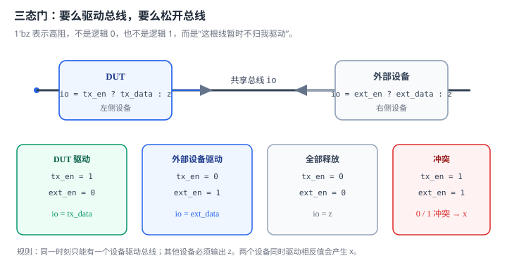

# 17 三态门与 inout

> 三态门多出的第三种状态叫**高阻 `z`**：表示“我现在不驱动这根线”，让别的设备来驱动。

---

## 1. 为什么需要高阻

普通输出只能驱动 0 或 1。如果两个设备同时把同一根线驱动成相反值，就会冲突，仿真结果是 `x`。

三态门增加一个选择：

```verilog
assign io = en ? data : 1'bz;
```

| `en` | `io` 的值 | 含义 |
|---|---|---|
| 1 | `data` | 本设备驱动总线 |
| 0 | `z` | 本设备松开总线 |

`z` 不是 0，也不是 1，而是高阻态。



---

## 2. `inout` 是什么

`input` 只能读，`output` 只能写，`inout` 既能读也能写：

```verilog
inout wire io;
```

| 端口 | 方向 |
|---|---|
| `input` | 只读 |
| `output` | 只写 |
| `inout` | 双向：有时驱动，有时读取 |

`inout` 通常连接 `wire`，因为同一根线可能有不同设备在驱动。

---

## 3. 最小双向模块

```verilog
module bidir_io (
    input      tx_data,
    input      tx_en,
    output     rx_data,
    inout wire io
);

    assign io = tx_en ? tx_data : 1'bz;
    assign rx_data = io;

endmodule
```

分段理解：

```text
tx_en=1  → io 输出 tx_data
tx_en=0  → io 变成 z，本模块不再驱动
rx_data  → 始终读取 io 当前的值
```

所以同一根 `io`：

- 本模块发送时：它被本模块驱动
- 本模块释放时：它可以被外部设备驱动
- 本模块通过 `rx_data` 读回当前总线值

完整源码：[`bidir_io.v`](../01_basics/advanced/bidir_io.v)

---

## 4. 三个设备状态

| DUT | 外部设备 | 总线结果 |
|---|---|---|
| 驱动 1 | 输出 z | `1` |
| 驱动 0 | 输出 z | `0` |
| 输出 z | 驱动 1 | `1` |
| 输出 z | 输出 z | `z` |
| 驱动 1 | 驱动 0 | `x`，冲突 |

核心规则：

> **同一时刻只能有一个设备真正驱动总线，其他设备必须输出 `z`。**

---

## 5. 测试

测试台用 `assign io = ext_en ? ext_data : 1'bz;` 模拟外部设备，和 DUT 共享同一根 `io`。

完整源码：[`bidir_io_tb.v`](../01_basics/advanced/bidir_io_tb.v)

运行：

```powershell
cd C:\Users\19918\Documents\verilog-lab\01_basics\advanced
iverilog -o bidir_io.vvp bidir_io.v bidir_io_tb.v
vvp bidir_io.vvp
```

实测输出：

```text
DUT 驱动 1: io=1 rx=1
PASS: DUT 驱动 1 正确
DUT 驱动 0: io=0 rx=0
PASS: DUT 驱动 0 正确
外部驱动 1: io=1 rx=1
PASS: DUT 读取外部 1 正确
全部释放: io=z rx=z
PASS: 总线进入高阻
```

---

## 6. 常见错误

| 现象 | 原因 |
|---|---|
| `io` 一直是 `x` | 两个设备同时驱动了相反值 |
| 外部设备驱动不了 | DUT 没有输出 `z`，还占着总线 |
| 把 `z` 当成 0 | `z` 是高阻，参与运算时通常仍是 `x` |
| 用 `reg` 写 `inout` | Verilog 中双向端口通常连接 `wire` |
| 忘记使能条件 | `inout` 必须配合 `en ? data : 1'bz` 控制方向 |

FPGA 内部通常不会大量使用三态长总线，三态更多出现在顶层双向引脚。现在只要理解 `1'bz` 和“同一时刻只能有一个驱动器”即可。

---

## 7. 小结

1. `1'bz` 表示高阻，意思是“松开总线”
2. `inout` 让一根端口既能驱动又能读取
3. 三态输出写成 `assign io = en ? data : 1'bz;`
4. 只能有一个设备同时驱动，否则冲突为 `x`
5. 到这里，Verilog 基础主线到阶段 5 结束